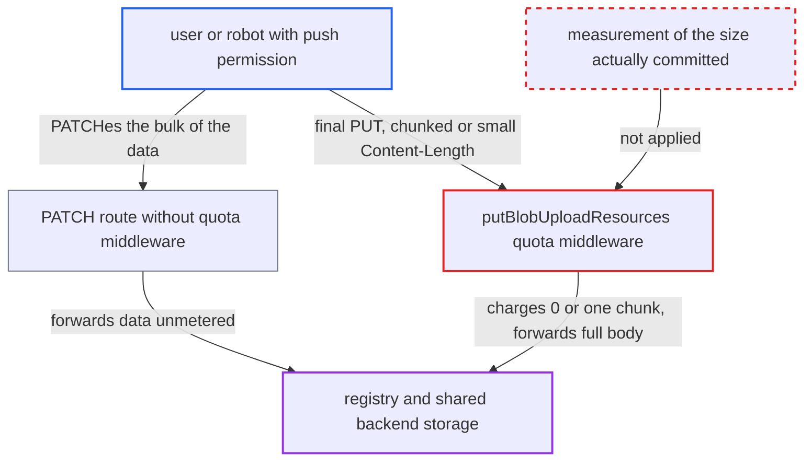

# Storage quota bypass: blob upload size taken from client Content-Length, not committed size

| Field | Value |
|---|---|
| ID | `find_01Q2vEujCQg8hsdNX736c32N` |
| Severity | **Medium** |
| Status | open |
| CWE | CWE-770 — Improper Enforcement of Resource Limit |
| Created | 2026-10-27T21:15:26.746969Z |
| Claude Security | https://claude.ai/security/findings/find_01Q2vEujCQg8hsdNX736c32N |

## Description

A user or robot with push permission on a project can store any amount of data in it, even when an administrator set a finite storage quota. This can fill the shared backend storage. The quota code takes the upload size from the client's `Content-Length` header on the final PUT, not from what the registry stores. The flaw is in `putBlobUploadResources`.

1. **attacker with push permission** opens an upload session with a POST. Only the `push` action is required on the repository, so any user or robot with push can do this, and the zero-size probe passes while the project is under quota. ([`src/server/middleware/v2auth/access.go:66-70`](https://github.com/cx-benchmark/harbor/blob/d822d80c2e6edb2c85538d4b9cd73c0c375a5596/src/server/middleware/v2auth/access.go#L66-L70))
2. **attacker** sends the data in a shape that hides its size. Either a monolithic `PUT` with `Transfer-Encoding: chunked`, or a `PATCH` of the bulk of the data followed by a final `PUT` with a small non-zero `Content-Length`; the `PATCH` route has no quota middleware. ([`src/server/registry/route.go:108-121`](https://github.com/cx-benchmark/harbor/blob/d822d80c2e6edb2c85538d4b9cd73c0c375a5596/src/server/registry/route.go#L108-L121))
3. **nginx** passes a chunked body through to core. The shipped config uses `proxy_http_version 1.1` and `proxy_request_buffering off` for `/v2/`, and Go's `net/http` then removes `Content-Length` from the chunked request. ([`make/photon/prepare/templates/nginx/nginx.https.conf.jinja:165-186`](https://github.com/cx-benchmark/harbor/blob/d822d80c2e6edb2c85538d4b9cd73c0c375a5596/make/photon/prepare/templates/nginx/nginx.https.conf.jinja#L165-L186))
4. **the function `putBlobUploadResources`** computes a wrong size to charge. It uses the `Content-Length` header and falls back to the accepted size from redis only when the header is missing or `0`. For a chunked upload with no earlier `PATCH` there is no redis entry, so the size is `0` and no quota is reserved. With a non-zero final `Content-Length`, only the final chunk is charged. ([`src/server/middleware/quota/put_blob_upload.go:40-52`](https://github.com/cx-benchmark/harbor/blob/d822d80c2e6edb2c85538d4b9cd73c0c375a5596/src/server/middleware/quota/put_blob_upload.go#L40-L52))
5. **the function `GetAcceptedBlobSize`** returns 0 when the session has no redis key. With no earlier `PATCH`, the fallback also gives `0`. ([`src/controller/blob/controller.go:340-357`](https://github.com/cx-benchmark/harbor/blob/d822d80c2e6edb2c85538d4b9cd73c0c375a5596/src/controller/blob/controller.go#L340-L357))
6. **the registry** stores the whole blob. The report assumes the pinned registry appends the full PUT body with an unbounded copy before committing the digest-verified blob.
7. **the post-response hook in `src/server/middleware/blob/put_blob_upload.go`** creates the `blob` row with the same wrong size. The size comes from `Content-Length`, else the accepted size. `Ensure` never corrects an existing row. ([`src/server/middleware/blob/put_blob_upload.go:50-66`](https://github.com/cx-benchmark/harbor/blob/d822d80c2e6edb2c85538d4b9cd73c0c375a5596/src/server/middleware/blob/put_blob_upload.go#L50-L66))
8. **the manifest push and quota refresh** never charge the missing bytes. The manifest quota charges only blobs not yet associated with the project. Refresh sums `blob.size` from the database, so it reports the same false size. ([`src/server/middleware/quota/put_manifest.go:64-84`](https://github.com/cx-benchmark/harbor/blob/d822d80c2e6edb2c85538d4b9cd73c0c375a5596/src/server/middleware/quota/put_manifest.go#L64-L84))

## Assessment

The attacker is a user or robot with `push` permission on a project whose storage limit was set by a system admin. They open an upload session with a POST. Then they use one of two routes. The first is a monolithic `PUT /v2/<name>/blobs/uploads/<session>?digest=` with `Transfer-Encoding: chunked` and a large body, which works through the shipped nginx. The second is a `PATCH` of the data followed by a final `PUT` with a small non-zero `Content-Length`, such as 1 byte. The second route works independently of chunked encoding or the front end. A manifest that references the blobs keeps them past GC at no further charge.

Impact: The attacker can store unbounded data in a quota-limited project, so the quota control is defeated. The `blob` table and quota usage permanently carry false sizes. In the shipped compose deployment, registry storage and Postgres share `data_volume: /data`, so the reasonable worst case is exhausting that storage. Pushes, and potentially the database, then fail for every project. No data is disclosed.

## Recommendation

The quota middleware and the blob bookkeeping take the blob size from client-controlled data, namely the `Content-Length` of the final PUT or a redis counter that is absent or ignored when the header is non-zero. An unknown size is treated as nothing to charge.

Fix criteria: Every blob committed through `PUT /v2/.../blobs/uploads/<session>` is charged and recorded at its real stored size, meaning all PATCHed bytes plus the final PUT body, whatever the transfer encoding. An upload whose size cannot be bounded before proxying is refused, or measured and rolled back on overflow. A chunked monolithic PUT of N bytes, or a PATCH of N-1 bytes plus a 1-byte PUT, to a project with quota Q \< N is refused. Successful uploads leave `blob.size` and quota usage equal to the real byte count.

## Evidence

**https://github.com/cx-benchmark/harbor**

- [`src/server/middleware/quota/put_blob_upload.go:40-52`](https://github.com/cx-benchmark/harbor/blob/d822d80c2e6edb2c85538d4b9cd73c0c375a5596/src/server/middleware/quota/put_blob_upload.go#L40-L52)
- [`src/server/middleware/blob/put_blob_upload.go:50-66`](https://github.com/cx-benchmark/harbor/blob/d822d80c2e6edb2c85538d4b9cd73c0c375a5596/src/server/middleware/blob/put_blob_upload.go#L50-L66)
- [`src/controller/blob/controller.go:340-357`](https://github.com/cx-benchmark/harbor/blob/d822d80c2e6edb2c85538d4b9cd73c0c375a5596/src/controller/blob/controller.go#L340-L357)
- [`src/controller/blob/controller.go:155-166`](https://github.com/cx-benchmark/harbor/blob/d822d80c2e6edb2c85538d4b9cd73c0c375a5596/src/controller/blob/controller.go#L155-L166)
- [`src/server/middleware/quota/put_manifest.go:64-84`](https://github.com/cx-benchmark/harbor/blob/d822d80c2e6edb2c85538d4b9cd73c0c375a5596/src/server/middleware/quota/put_manifest.go#L64-L84)
- [`src/pkg/blob/dao/dao.go:289-312`](https://github.com/cx-benchmark/harbor/blob/d822d80c2e6edb2c85538d4b9cd73c0c375a5596/src/pkg/blob/dao/dao.go#L289-L312)
- [`src/server/registry/route.go:108-121`](https://github.com/cx-benchmark/harbor/blob/d822d80c2e6edb2c85538d4b9cd73c0c375a5596/src/server/registry/route.go#L108-L121)
- [`make/photon/prepare/templates/nginx/nginx.https.conf.jinja:165-186`](https://github.com/cx-benchmark/harbor/blob/d822d80c2e6edb2c85538d4b9cd73c0c375a5596/make/photon/prepare/templates/nginx/nginx.https.conf.jinja#L165-L186)
- [`src/server/middleware/v2auth/access.go:66-70`](https://github.com/cx-benchmark/harbor/blob/d822d80c2e6edb2c85538d4b9cd73c0c375a5596/src/server/middleware/v2auth/access.go#L66-L70)

