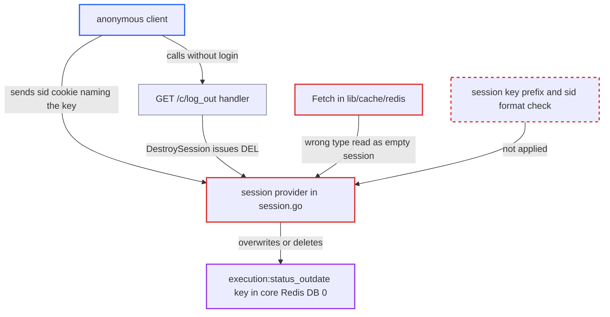

# Unprefixed session cookie used as Redis key lets anonymous clients overwrite and delete core Redis keys

| Field | Value |
|---|---|
| ID | `find_015xmfiGPDrbYrxt1ryYWUNr` |
| Severity | **Medium** |
| Status | open |
| CWE | CWE-99 — Resource injection |
| Created | 2026-10-27T21:18:56.509307Z |
| Claude Security | https://claude.ai/security/findings/find_015xmfiGPDrbYrxt1ryYWUNr |

## Description

An anonymous internet client can overwrite or delete keys in Harbor's core Redis database, including `execution:status_outdate`. This breaks job status recording: replication, scan, GC, retention, preheat and webhook executions stay `Running`. The attacker only has to send a chosen `sid` cookie. The session provider in `src/core/session/session.go` uses that cookie value as the Redis key, with no prefix and no format check. Push/pull and data confidentiality are not affected.

1. **anonymous client** sends a request with the cookie `sid=execution:status_outdate`. The key name is a constant in the source, and the session provider uses the cookie value as the Redis key, with no prefix and no format check. ([`src/core/session/session.go:142-177`](https://github.com/cx-benchmark/harbor/blob/d822d80c2e6edb2c85538d4b9cd73c0c375a5596/src/core/session/session.go#L142-L177))
2. **session provider** accepts the existing key as a session. `SessionExist` runs `EXISTS` and `SessionRead` runs `GET` on the raw cookie value, and the `GET` fails with `WRONGTYPE` because the key is a Redis SET. ([`src/core/session/session.go:142-177`](https://github.com/cx-benchmark/harbor/blob/d822d80c2e6edb2c85538d4b9cd73c0c375a5596/src/core/session/session.go#L142-L177))
3. **the function `Fetch`** reports the `WRONGTYPE` error as `cache.ErrNotFound`. `SessionRead` tolerates that error and returns an empty session instead of refusing the foreign key. ([`src/lib/cache/redis/redis.go:53-70`](https://github.com/cx-benchmark/harbor/blob/d822d80c2e6edb2c85538d4b9cd73c0c375a5596/src/lib/cache/redis/redis.go#L53-L70))
4. **the function `releaseSession`** writes a string over the key after the request. It runs `SET <key> <gob> EX <session timeout>`, and Redis `SET` replaces a key of any type, so the SET becomes a string. Later requests keep it a string and renew its TTL. ([`src/core/session/session.go:89-122`](https://github.com/cx-benchmark/harbor/blob/d822d80c2e6edb2c85538d4b9cd73c0c375a5596/src/core/session/session.go#L89-L122))
5. **anonymous client** alternatively calls `GET /c/log_out` with the same cookie. This needs no login. It reaches `DestroySession`, which makes the provider run `DEL` on the cookie-named key of any type. ([`src/core/controllers/base.go:112-145`](https://github.com/cx-benchmark/harbor/blob/d822d80c2e6edb2c85538d4b9cd73c0c375a5596/src/core/controllers/base.go#L112-L145))
6. **the functions `AsyncRefreshStatus` and `scanAndRefreshOutdateStatus`** fail on the key with `WRONGTYPE`. `SADD` and `SPOPN` cannot work on a string, and members already queued are lost when the key is overwritten or deleted. ([`src/pkg/task/dao/execution.go:530-561`](https://github.com/cx-benchmark/harbor/blob/d822d80c2e6edb2c85538d4b9cd73c0c375a5596/src/pkg/task/dao/execution.go#L530-L561))
7. **the job status hook handler** returns an error and the transaction middleware rolls back the task status update. Jobservice retries the hook for only 5 minutes (`errRetryBackoff`) and then drops it, so the status changes are lost. ([`src/jobservice/hook/hook_agent.go:35-36`](https://github.com/cx-benchmark/harbor/blob/d822d80c2e6edb2c85538d4b9cd73c0c375a5596/src/jobservice/hook/hook_agent.go#L35-L36))

## Assessment

The attacker is an anonymous client reaching `/api/v2.0/*` or `/c/*` over HTTP, with no login. The SET `execution:status_outdate` exists only between a job status hook and the next drain, which runs every 30 seconds by default in the default async mode. The attacker therefore repeats `GET /api/v2.0/systeminfo` with `Cookie: sid=execution:status_outdate` until a request lands in that window. The overwrite then stays in place while requests continue. The other route is `GET /c/log_out` with the same cookie, which deletes the key instead. Logging in with such a cookie also runs `RENAME` on the key. The attack works against the shipped configuration because sessions and Harbor's business data share core Redis DB 0. `_REDIS_URL_HARBOR` is emitted only when `harbor_db_index` is configured, and the code falls back to `_REDIS_URL_CORE`. The report assumes beego `v2.3.10` starts the session on every request, returns the unvalidated cookie value from `getSid`, and passes it to `provider.SessionDestroy`. That code is not in the checkout.

Impact: The attacker can delete any key in the core Redis DB and overwrite or rename non-string keys there. Overwriting `execution:status_outdate` discards queued refreshes. While the attacker holds the key, every job status hook fails and rolls back, so tasks and executions stay `Running` until an administrator stops them. Single-active replication policies skip every later run. String keys that hold non-gob data, such as `cache:*`, cannot be overwritten, because decoding fails and the request ends in a 503, but they can still be deleted through `/c/log_out`. Other users' sessions are not reachable, because their sids are random. The loss is limited to job-state data and a degraded job subsystem.

## Recommendation

(1) The session provider uses the client-controlled cookie value as the Redis key, with no namespace and no validation. A client can address, overwrite, rename and delete keys of other Harbor subsystems in the same Redis DB, including through the unauthenticated `/c/log_out` path.

Fix criteria: Session keys live in a dedicated namespace, applied the same way in `SessionExist`, `SessionRead`, `releaseSession`, `SessionRegenerate` and `SessionDestroy`. Alternatively, or additionally, the sid is checked against the exact format beego generates before any Redis command runs. A request or `/c/log_out` call with `Cookie: sid=execution:status_outdate` must neither read, write, rename nor delete that key.

(2) `lib/cache/redis.Fetch` reports `WRONGTYPE` and other non-nil Redis errors as `cache.ErrNotFound`. The session layer therefore treats a foreign key as an empty but existing session instead of refusing it.

Fix criteria: A `GET` that fails for any reason other than the key being absent reaches `SessionRead` as an error, and the session is rejected with no release or overwrite. A cookie naming a set or hash key leaves that key untouched.

## Evidence

**https://github.com/cx-benchmark/harbor**

- [`src/core/session/session.go:142-177`](https://github.com/cx-benchmark/harbor/blob/d822d80c2e6edb2c85538d4b9cd73c0c375a5596/src/core/session/session.go#L142-L177)
- [`src/core/session/session.go:89-122`](https://github.com/cx-benchmark/harbor/blob/d822d80c2e6edb2c85538d4b9cd73c0c375a5596/src/core/session/session.go#L89-L122)
- [`src/core/session/session.go:179-222`](https://github.com/cx-benchmark/harbor/blob/d822d80c2e6edb2c85538d4b9cd73c0c375a5596/src/core/session/session.go#L179-L222)
- [`src/core/controllers/base.go:112-145`](https://github.com/cx-benchmark/harbor/blob/d822d80c2e6edb2c85538d4b9cd73c0c375a5596/src/core/controllers/base.go#L112-L145)
- [`src/lib/cache/redis/redis.go:53-70`](https://github.com/cx-benchmark/harbor/blob/d822d80c2e6edb2c85538d4b9cd73c0c375a5596/src/lib/cache/redis/redis.go#L53-L70)
- [`src/core/main.go:147-171`](https://github.com/cx-benchmark/harbor/blob/d822d80c2e6edb2c85538d4b9cd73c0c375a5596/src/core/main.go#L147-L171)
- [`make/photon/prepare/utils/configs.py:480-485`](https://github.com/cx-benchmark/harbor/blob/d822d80c2e6edb2c85538d4b9cd73c0c375a5596/make/photon/prepare/utils/configs.py#L480-L485)
- [`src/lib/redis/client.go:64-89`](https://github.com/cx-benchmark/harbor/blob/d822d80c2e6edb2c85538d4b9cd73c0c375a5596/src/lib/redis/client.go#L64-L89)
- [`src/pkg/task/dao/execution.go:530-561`](https://github.com/cx-benchmark/harbor/blob/d822d80c2e6edb2c85538d4b9cd73c0c375a5596/src/pkg/task/dao/execution.go#L530-L561)
- [`src/pkg/task/hook.go:147-165`](https://github.com/cx-benchmark/harbor/blob/d822d80c2e6edb2c85538d4b9cd73c0c375a5596/src/pkg/task/hook.go#L147-L165)
- [`src/server/middleware/transaction/transaction.go:56-64`](https://github.com/cx-benchmark/harbor/blob/d822d80c2e6edb2c85538d4b9cd73c0c375a5596/src/server/middleware/transaction/transaction.go#L56-L64)
- [`src/jobservice/hook/hook_agent.go:35-36`](https://github.com/cx-benchmark/harbor/blob/d822d80c2e6edb2c85538d4b9cd73c0c375a5596/src/jobservice/hook/hook_agent.go#L35-L36)
- [`src/controller/replication/execution.go:114-140`](https://github.com/cx-benchmark/harbor/blob/d822d80c2e6edb2c85538d4b9cd73c0c375a5596/src/controller/replication/execution.go#L114-L140)

