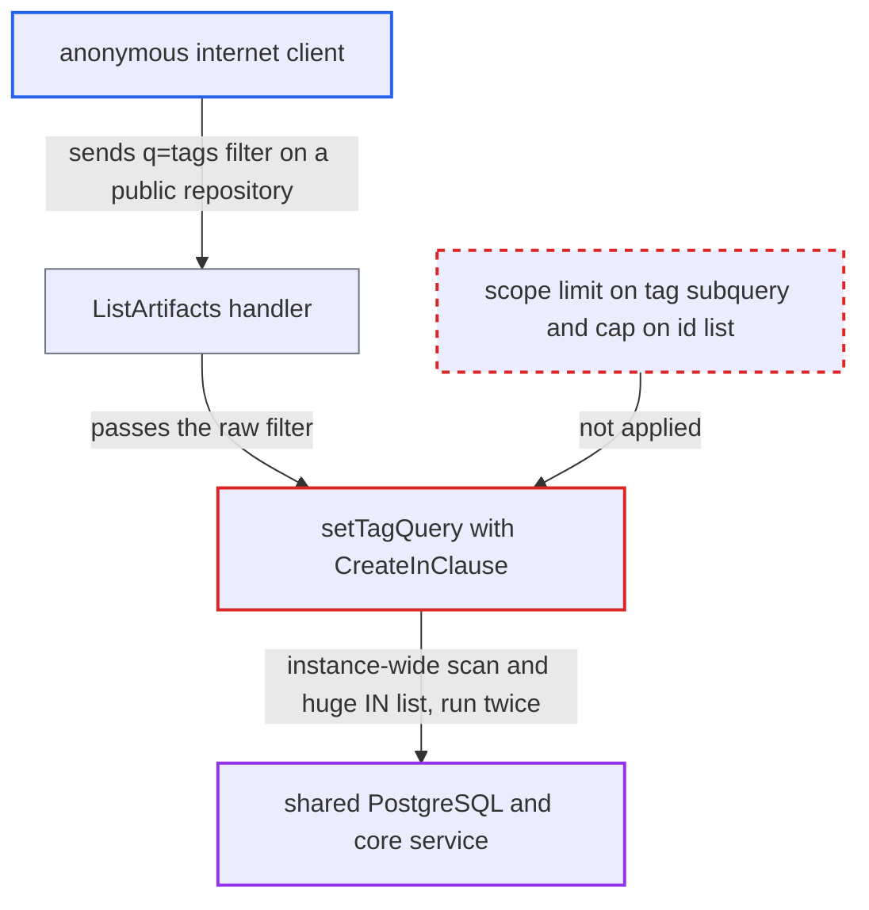

# Unscoped tag subquery materialized into giant IN list enables anonymous DB resource exhaustion

| Field | Value |
|---|---|
| ID | `find_01L46jAzrK9s1La3bBuS6PsX` |
| Severity | **Medium** |
| Status | open |
| CWE | CWE-770 — Resource exhaustion |
| Created | 2026-10-27T21:18:26.012970Z |
| Claude Security | https://claude.ai/security/findings/find_01L46jAzrK9s1La3bBuS6PsX |

## Description

An anonymous internet client can slow down or degrade a Harbor instance's shared database and core service for all users. It needs only one public repository, such as the default public `library`, and a registry holding many tagged artifacts. The tag filter code `setTagQuery` scans the whole instance's tags and splices every matching id into one huge `IN (...)` list, with no cap.

1. **anonymous client** sends a list request with a tag filter on a public repository. The request is `GET /api/v2.0/projects/
/repositories/<r>/artifacts?q=tags=~e`, and the public project only needs the list permission. ([`src/common/rbac/project/rbac_util.go:38-39`](https://github.com/cx-benchmark/harbor/blob/d822d80c2e6edb2c85538d4b9cd73c0c375a5596/src/common/rbac/project/rbac_util.go#L38-L39))
2. **the handler `ListArtifacts`** passes the raw `q` parameter on to the query builder. It checks only `ActionList` on `ResourceArtifact` and adds `RepositoryName` to the outer query, which does not limit the tag subquery. ([`src/server/v2.0/handler/artifact.go:84-110`](https://github.com/cx-benchmark/harbor/blob/d822d80c2e6edb2c85538d4b9cd73c0c375a5596/src/server/v2.0/handler/artifact.go#L84-L110))
3. **`setTagQuery`** runs an instance-wide subquery over `artifact` joined with `tag`. The subquery uses `tag.name LIKE ?` (or `= ?`) with no LIMIT and no repository or project scope, so it fully scans `tag` and then applies DISTINCT. ([`src/pkg/artifact/dao/dao.go:395-430`](https://github.com/cx-benchmark/harbor/blob/d822d80c2e6edb2c85538d4b9cd73c0c375a5596/src/pkg/artifact/dao/dao.go#L395-L430))
4. **`CreateInClause`** loads every matching artifact id into a Go slice and formats it as a literal `IN (...)` string. The number of elements is not capped, so the SQL text can reach megabytes. ([`src/lib/orm/orm.go:256-276`](https://github.com/cx-benchmark/harbor/blob/d822d80c2e6edb2c85538d4b9cd73c0c375a5596/src/lib/orm/orm.go#L256-L276))
5. **`Count` and `List`** each rebuild and run this query. Both call `querySetter`, so the scan and the giant statement run twice for one API request, and PostgreSQL must parse and plan every constant each time. ([`src/pkg/artifact/dao/dao.go:91-112`](https://github.com/cx-benchmark/harbor/blob/d822d80c2e6edb2c85538d4b9cd73c0c375a5596/src/pkg/artifact/dao/dao.go#L91-L112))

## Assessment

The attacker is an unauthenticated client on a public instance, and needs no login. They pick any existing repository in a public project, such as the default public `library`, and send the list request with a `tags` filter. Fuzzy `tags=~x` and exact `tags=x` both reach the code. The ORM sets no statement timeout, and the shipped nginx configuration has no request rate limit. The effect depends on the instance holding many tagged artifacts and on a public repository existing. The same pattern also exists for user-supplied `ExtraAttrs.*` or `extra_attrs.*` query keys on executions and tasks in `src/pkg/task/dao/execution.go` and `src/pkg/task/dao/task.go`. These keys are reachable through `q` in the preheat and webhook execution and task listings, for example with a key shared by every scan execution such as `enabled_capabilities.type`. Those endpoints require project-level permissions.

Impact: The attacker gains no data and changes nothing. Each cheap request forces heavy work on the shared PostgreSQL instance and on core, and that work grows with the registry's total tagged-artifact count. Concurrent requests degrade API and registry operations for all users while they continue, and service recovers when they stop.

## Recommendation

(1) `setTagQuery` builds its tag subquery over the whole `artifact` and `tag` tables instead of the repository or project being listed. `CreateInClause` also puts an unbounded number of ids into the SQL text, so a caller-controlled filter triggers work proportional to instance size.

Fix criteria: The tag filter is evaluated only within the rows the outer query already restricts to (for example a correlated `EXISTS`, or a subquery carrying the same `repository_name` or `project_id` predicate), or the materialized id list is bounded. A request with `q=tags=~e` or `q=tags=latest` on a single repository produces a statement whose cost depends only on that repository's tags. `EXPLAIN` of the generated SQL shows no instance-wide scan of `tag`.

(2) The `ExtraAttrs.*` filters for executions and tasks use the same unscoped `select id from execution/task where extra_attrs->>?=?` subquery fed into `CreateInClause`.

Fix criteria: The `extra_attrs` subquery is scoped by the vendor type/ID (or execution ID) that the handler already set, or the JSON condition is expressed directly in the outer query. The work done is then bounded by the caller's own executions.

## Evidence

**https://github.com/cx-benchmark/harbor**

- [`src/pkg/artifact/dao/dao.go:395-430`](https://github.com/cx-benchmark/harbor/blob/d822d80c2e6edb2c85538d4b9cd73c0c375a5596/src/pkg/artifact/dao/dao.go#L395-L430)
- [`src/lib/orm/orm.go:256-276`](https://github.com/cx-benchmark/harbor/blob/d822d80c2e6edb2c85538d4b9cd73c0c375a5596/src/lib/orm/orm.go#L256-L276)
- [`src/pkg/artifact/dao/dao.go:91-112`](https://github.com/cx-benchmark/harbor/blob/d822d80c2e6edb2c85538d4b9cd73c0c375a5596/src/pkg/artifact/dao/dao.go#L91-L112)
- [`src/server/v2.0/handler/artifact.go:84-110`](https://github.com/cx-benchmark/harbor/blob/d822d80c2e6edb2c85538d4b9cd73c0c375a5596/src/server/v2.0/handler/artifact.go#L84-L110)
- [`src/common/rbac/project/rbac_util.go:38-39`](https://github.com/cx-benchmark/harbor/blob/d822d80c2e6edb2c85538d4b9cd73c0c375a5596/src/common/rbac/project/rbac_util.go#L38-L39)
- [`src/pkg/task/dao/execution.go:420-428`](https://github.com/cx-benchmark/harbor/blob/d822d80c2e6edb2c85538d4b9cd73c0c375a5596/src/pkg/task/dao/execution.go#L420-L428)

