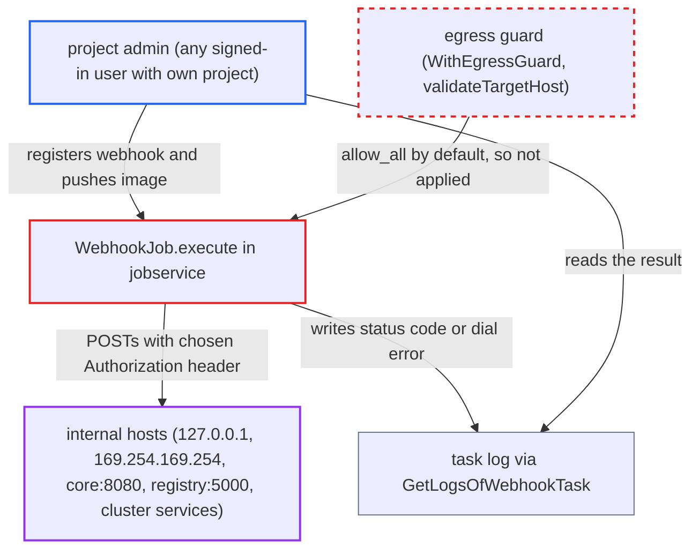

# Webhook egress guard defaults to allow_all, enabling SSRF from jobservice to internal hosts

| Field | Value |
|---|---|
| ID | `find_01Tvc7aFt1etPowoKMDjjNmf` |
| Severity | **Medium** |
| Status | open |
| CWE | CWE-918 — Server-Side Request Forgery |
| Created | 2026-10-27T21:09:04.827768Z |
| Claude Security | https://claude.ai/security/findings/find_01Tvc7aFt1etPowoKMDjjNmf |

## Description

Any signed-in Harbor user can make Harbor's jobservice send POST requests to internal hosts and read back the result. That includes cloud metadata addresses and Harbor's own components. Creating a project makes the user its admin, and `project_creation_restriction` defaults to `everyone`. The cause is `parseEgressLevel`, which treats an unset `HARBOR_WEBHOOK_EGRESS_POLICY` as `allow_all`, so the egress guard filters nothing by default.

1. **attacker (project admin)** creates a webhook policy pointing at an internal URL. The target address is any `http(s)://` URL, and the `Authorization` header value and `skip_cert_verify` are also attacker-chosen. ([`src/server/v2.0/handler/webhook.go:421-431`](https://github.com/cx-benchmark/harbor/blob/d822d80c2e6edb2c85538d4b9cd73c0c375a5596/src/server/v2.0/handler/webhook.go#L421-L431))
2. **`parseEgressLevel`** returns `egressAllowAll` for the default install. Both `HARBOR_WEBHOOK_EGRESS_POLICY` and `HARBOR_ALLOW_PRIVATE_NETWORK_ACCESS` are empty, so `checkAddress` and `ValidateNetworkTarget` return without checking anything, and `validateTargetHost` accepts the target. ([`src/common/http/private_network.go:207-233`](https://github.com/cx-benchmark/harbor/blob/d822d80c2e6edb2c85538d4b9cd73c0c375a5596/src/common/http/private_network.go#L207-L233))
3. **installer** writes an empty policy into the env files. `configs.py` emits an empty `HARBOR_WEBHOOK_EGRESS_POLICY=` when the operator sets nothing, while `harbor.yml.tmpl` still says `block_restricted` is the default, so operators think they are protected. ([`make/photon/prepare/utils/configs.py:220-227`](https://github.com/cx-benchmark/harbor/blob/d822d80c2e6edb2c85538d4b9cd73c0c375a5596/make/photon/prepare/utils/configs.py#L220-L227))
4. **attacker** pushes or pulls an artifact in their own project. This fires the matching event, for example PUSH_ARTIFACT.
5. **the job `WebhookJob.execute`** POSTs the notification to the internal address with the attacker's `Authorization` header. The HTTP client relies only on `WithEgressGuard()` for filtering, and that guard is off under `allow_all`. ([`src/jobservice/job/impl/notification/webhook_job.go:100-130`](https://github.com/cx-benchmark/harbor/blob/d822d80c2e6edb2c85538d4b9cd73c0c375a5596/src/jobservice/job/impl/notification/webhook_job.go#L100-L130))
6. **attacker** reads the task log through `GetLogsOfWebhookTask`. The log shows `abnormal response code: %d` or the dial error, which includes the resolved IP and port, so the attacker can tell which internal hosts and ports answer. ([`src/server/v2.0/handler/webhook.go:356-386`](https://github.com/cx-benchmark/harbor/blob/d822d80c2e6edb2c85538d4b9cd73c0c375a5596/src/server/v2.0/handler/webhook.go#L356-L386))

## Assessment

The attacker is any authenticated Harbor user. Because `project_creation_restriction` defaults to `everyone`, such a user can create a project and become its admin. They call `POST /api/v2.0/projects/{p}/webhook/policies` with an internal URL in `targets[0].address`, any `auth_header`, and event type PUSH_ARTIFACT. They then push an image to their project. The attack works on a default installation with no `webhook_egress` section and no egress environment variables set. The API is reachable over the network. The same route works for Slack notification targets.

Impact: The attacker can map internal hosts, ports and DNS names from the status codes and dial errors in the job log. They can also make the jobservice send blind POSTs with a chosen `Authorization` header to Harbor's own components. The body is a mostly fixed notification JSON and redirects are blocked. The response body is not shown, so direct data theft or state change on Harbor is limited.

Subsequent-system impact: The jobservice can be pointed at systems beyond Harbor: cloud instance metadata endpoints, Kubernetes or cluster services, and any internal HTTP service it can reach. Only POST with a semi-fixed JSON body and an attacker-chosen `Authorization` header is possible, and the response body is not disclosed. The effect there is reconnaissance plus blind POST side effects on services that need no authentication.

## Recommendation

(1) `parseEgressLevel` in `src/common/http/private_network.go` treats an unset policy as `allow_all`. This turns off every destination check in both the API validation and the jobservice dialer. The installer documents `block_restricted` as the default.

Fix criteria: A default installation (no `webhook_egress` section, empty `HARBOR_WEBHOOK_EGRESS_POLICY` and `HARBOR_ALLOW_PRIVATE_NETWORK_ACCESS`) refuses webhook targets that resolve to loopback, unspecified, link-local, multicast and cloud-metadata addresses, both when a policy is created and at dial time. The shipped `harbor.yml.tmpl` and prepare defaults match the code's actual default. Creating a policy for `http://127.0.0.1:8080/` or `http://169.254.169.254/` with no egress configuration is rejected with 400. A pre-existing policy with such a target fails at dial time without connecting.

(2) The job log and task status show the remote status code and the full dial error, including the resolved IP, for destinations the attacker chose. This turns the blind request into a reconnaissance oracle.

Fix criteria: Errors shown to project users for notification deliveries do not include resolved IP addresses or raw transport error strings for blocked or failed destinations. The task log for a failed delivery to an internal address does not reveal the resolved address. It also does not distinguish a refused connection from a filtered one.

## Evidence

**https://github.com/cx-benchmark/harbor**

- [`src/common/http/private_network.go:207-233`](https://github.com/cx-benchmark/harbor/blob/d822d80c2e6edb2c85538d4b9cd73c0c375a5596/src/common/http/private_network.go#L207-L233)
- [`make/harbor.yml.tmpl:261-272`](https://github.com/cx-benchmark/harbor/blob/d822d80c2e6edb2c85538d4b9cd73c0c375a5596/make/harbor.yml.tmpl#L261-L272)
- [`make/photon/prepare/utils/configs.py:220-227`](https://github.com/cx-benchmark/harbor/blob/d822d80c2e6edb2c85538d4b9cd73c0c375a5596/make/photon/prepare/utils/configs.py#L220-L227)
- [`src/server/v2.0/handler/webhook.go:421-431`](https://github.com/cx-benchmark/harbor/blob/d822d80c2e6edb2c85538d4b9cd73c0c375a5596/src/server/v2.0/handler/webhook.go#L421-L431)
- [`src/jobservice/job/impl/notification/webhook_job.go:100-130`](https://github.com/cx-benchmark/harbor/blob/d822d80c2e6edb2c85538d4b9cd73c0c375a5596/src/jobservice/job/impl/notification/webhook_job.go#L100-L130)
- [`src/jobservice/job/impl/notification/http_helper.go:63-85`](https://github.com/cx-benchmark/harbor/blob/d822d80c2e6edb2c85538d4b9cd73c0c375a5596/src/jobservice/job/impl/notification/http_helper.go#L63-L85)
- [`src/server/v2.0/handler/webhook.go:356-386`](https://github.com/cx-benchmark/harbor/blob/d822d80c2e6edb2c85538d4b9cd73c0c375a5596/src/server/v2.0/handler/webhook.go#L356-L386)

