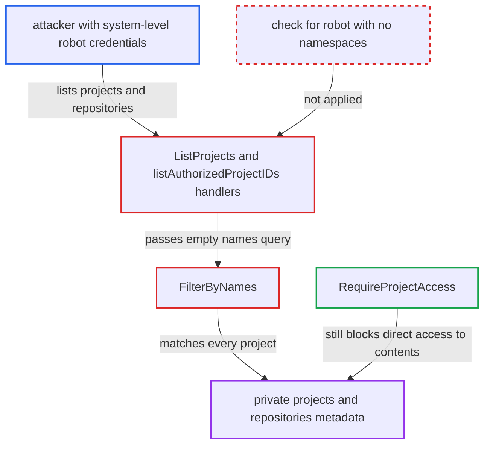

# Fail-open empty names filter lets permissionless robot list all private projects and repositories

| Field | Value |
|---|---|
| ID | `find_01LAsssuxgYUv6GwbJ3iHkbw` |
| Severity | **Low** |
| Status | open |
| CWE | CWE-863 — Missing authorization |
| Created | 2026-10-27T21:08:40.501079Z |
| Claude Security | https://claude.ai/security/findings/find_01LAsssuxgYUv6GwbJ3iHkbw |

## Description

A system-level robot account whose scoped projects have all been deleted can list every private project and repository in the Harbor instance. It sees project metadata, owner names, CVE allowlists and repository names, but not artifact content. The cause is `FilterByNames` in `src/pkg/project/models/project.go`, which applies no filter when `Names` is empty. `ListProjects` and `listAuthorizedProjectIDs` never check for that case.

1. **sysadmin** creates a system-level robot scoped only to project-level permissions. `validate` allows a system-level robot (`project_id = 0`) whose permissions are all project-kind on named projects. ([`src/server/v2.0/handler/robot.go:358-412`](https://github.com/cx-benchmark/harbor/blob/d822d80c2e6edb2c85538d4b9cd73c0c375a5596/src/server/v2.0/handler/robot.go#L358-L412))
2. **project admin** deletes the project the robot is scoped to. Deletion is a soft delete, and `DeleteByProjectID` removes only robots whose `project_id` is that project. The system-level robot and its `role_permission` rows stay. ([`src/pkg/robot/dao/dao.go:138-147`](https://github.com/cx-benchmark/harbor/blob/d822d80c2e6edb2c85538d4b9cd73c0c375a5596/src/pkg/robot/dao/dao.go#L138-L147))
3. **attacker** authenticates with the robot's credentials. The robot security context is built after only the secret, disabled and expiry checks, so a robot with no permissions still logs in. ([`src/server/middleware/security/robot.go:33-73`](https://github.com/cx-benchmark/harbor/blob/d822d80c2e6edb2c85538d4b9cd73c0c375a5596/src/server/middleware/security/robot.go#L33-L73))
4. **`populatePermissions`** skips every scope whose project returns NotFound. The deleted project now resolves to NotFound, so `r.Permissions` ends up empty. ([`src/controller/robot/controller.go:276-328`](https://github.com/cx-benchmark/harbor/blob/d822d80c2e6edb2c85538d4b9cd73c0c375a5596/src/controller/robot/controller.go#L276-L328))
5. **attacker** calls `GET /api/v2.0/projects?public=false` or `GET /api/v2.0/repositories`. The handlers `ListProjects` and `listAuthorizedProjectIDs` build a `NamesQuery` from the empty `Permissions` and do not check that it is empty. ([`src/server/v2.0/handler/project.go:483-527`](https://github.com/cx-benchmark/harbor/blob/d822d80c2e6edb2c85538d4b9cd73c0c375a5596/src/server/v2.0/handler/project.go#L483-L527))
6. **`FilterByNames`** returns the query unchanged because `Names` is empty. No `project_id IN (...)` condition is added and the `WithPublic` restriction is dropped, so every non-deleted project matches. ([`src/pkg/project/models/project.go:254-276`](https://github.com/cx-benchmark/harbor/blob/d822d80c2e6edb2c85538d4b9cd73c0c375a5596/src/pkg/project/models/project.go#L254-L276))

## Assessment

The attacker holds the credentials of a system-level robot whose project-scoped permissions all point at projects that were later deleted. For example, a sysadmin issued the robot for project P, and P's admin then deleted the empty project. The attacker sends the request with robot basic auth to `GET /api/v2.0/projects?public=false` or `GET /api/v2.0/repositories`. The report says `/api/v2.0/*` is exposed to the internet.

Impact: The attacker learns the full inventory of private projects: names, owner usernames, metadata (public flag, content-trust and vulnerability-prevention settings), CVE allowlists and repository counts. The attacker also learns every private repository's name, artifact count and pull count. Artifact content, scan reports and pushes stay behind `RequireProjectAccess`, so the loss is limited to metadata.

## Recommendation

(1) `FilterByNames` treats an empty name list as no restriction instead of "match nothing" or "public only". Callers that rely on it to scope visibility therefore fail open.

Fix criteria: With an empty `NamesQuery.Names`, the filter still restricts results: only public projects when `WithPublic` is set, and no projects otherwise. A robot whose `Permissions` is empty gets only public projects from `GET /api/v2.0/projects` and only public projects' repositories from `GET /api/v2.0/repositories`. It gets nothing with `public=false`.

(2) `ListProjects` and `listAuthorizedProjectIDs` derive a robot's visibility from its namespaces without handling a robot that has none. Dangling permission rows of system-level robots also survive project deletion.

Fix criteria: Both handlers explicitly treat a robot with no resolvable project namespace as having no private-project visibility. Project deletion, or permission resolution, no longer leaves a system robot scoped only to deleted projects with an unrestricted listing. This is verified with a system robot whose only scoped project was deleted.

## Evidence

**https://github.com/cx-benchmark/harbor**

- [`src/pkg/project/models/project.go:254-276`](https://github.com/cx-benchmark/harbor/blob/d822d80c2e6edb2c85538d4b9cd73c0c375a5596/src/pkg/project/models/project.go#L254-L276)
- [`src/server/v2.0/handler/project.go:483-527`](https://github.com/cx-benchmark/harbor/blob/d822d80c2e6edb2c85538d4b9cd73c0c375a5596/src/server/v2.0/handler/project.go#L483-L527)
- [`src/server/v2.0/handler/repository.go:113-166`](https://github.com/cx-benchmark/harbor/blob/d822d80c2e6edb2c85538d4b9cd73c0c375a5596/src/server/v2.0/handler/repository.go#L113-L166)
- [`src/controller/robot/controller.go:276-328`](https://github.com/cx-benchmark/harbor/blob/d822d80c2e6edb2c85538d4b9cd73c0c375a5596/src/controller/robot/controller.go#L276-L328)
- [`src/pkg/project/dao/dao.go:112-142`](https://github.com/cx-benchmark/harbor/blob/d822d80c2e6edb2c85538d4b9cd73c0c375a5596/src/pkg/project/dao/dao.go#L112-L142)
- [`src/pkg/robot/dao/dao.go:138-147`](https://github.com/cx-benchmark/harbor/blob/d822d80c2e6edb2c85538d4b9cd73c0c375a5596/src/pkg/robot/dao/dao.go#L138-L147)
- [`src/server/v2.0/handler/robot.go:358-412`](https://github.com/cx-benchmark/harbor/blob/d822d80c2e6edb2c85538d4b9cd73c0c375a5596/src/server/v2.0/handler/robot.go#L358-L412)
- [`src/server/middleware/security/robot.go:33-73`](https://github.com/cx-benchmark/harbor/blob/d822d80c2e6edb2c85538d4b9cd73c0c375a5596/src/server/middleware/security/robot.go#L33-L73)

