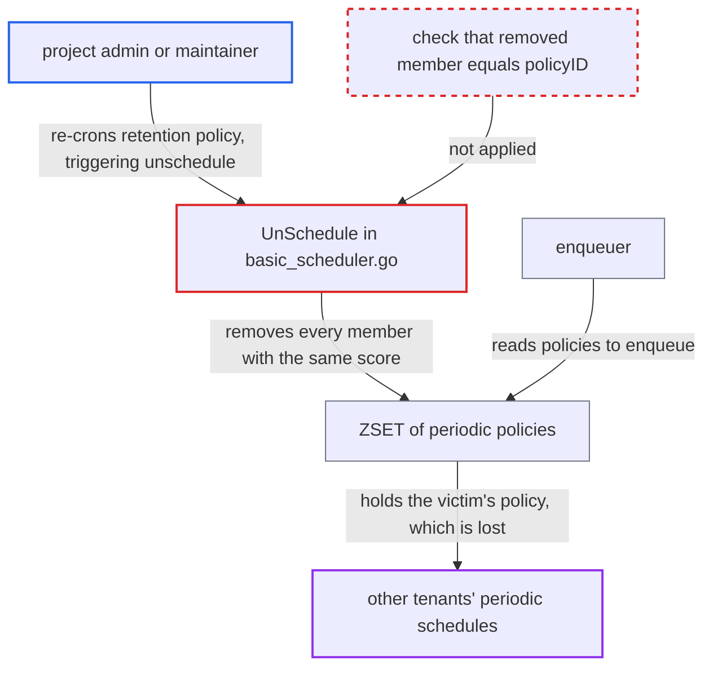

# Periodic job unschedule deletes other tenants' policies sharing a non-unique numeric ID

| Field | Value |
|---|---|
| ID | `find_01Dowy6FXkLzsVmLwxGo9zCf` |
| Severity | **Low** |
| Status | open |
| CWE | CWE-694 — Insufficient uniqueness of identifier |
| Created | 2026-10-27T21:11:45.224965Z |
| Claude Security | https://claude.ai/security/findings/find_01Dowy6FXkLzsVmLwxGo9zCf |

## Description

A logged-in user who is a project admin or maintainer can make other tenants' periodic schedules silently stop firing, including system jobs such as GC and scan-all. Harbor still shows them as scheduled. It needs another schedule to be created or updated within about 10 seconds of the attacker's. `UnSchedule` deletes by a non-unique score instead of removing the exact policy.

1. **attacker (project admin or maintainer)** changes the cron of their own retention policy again and again. Each update unschedules the previous policy and schedules a new one, and the attacker can repeat this as often as they like. ([`src/controller/retention/controller.go:149-199`](https://github.com/cx-benchmark/harbor/blob/d822d80c2e6edb2c85538d4b9cd73c0c375a5596/src/controller/retention/controller.go#L149-L199))
2. **`Schedule()`** gives each new policy a numeric ID of the current Unix second plus a random offset. The ID is `time.Now().Unix() + rand.Int63n(10)`, it is stored as the ZSET score, and nothing checks that it is unique. ([`src/jobservice/period/basic_scheduler.go:92-98`](https://github.com/cx-benchmark/harbor/blob/d822d80c2e6edb2c85538d4b9cd73c0c375a5596/src/jobservice/period/basic_scheduler.go#L92-L98))
3. **core scheduler** stops the old periodic job through jobservice. `UnScheduleByID` makes the task manager post `stop` for the periodic job ID, and `StopJob()` then calls `scheduler.UnSchedule(jobID)`. ([`src/jobservice/worker/cworker/c_worker.go:329-345`](https://github.com/cx-benchmark/harbor/blob/d822d80c2e6edb2c85538d4b9cd73c0c375a5596/src/jobservice/worker/cworker/c_worker.go#L329-L345))
4. **`locatePolicy()`** turns the `policyID` into the numeric ID kept in the job stats. That numeric ID is the score that is shared with any other policy that drew the same value. ([`src/jobservice/period/basic_scheduler.go:177-208`](https://github.com/cx-benchmark/harbor/blob/d822d80c2e6edb2c85538d4b9cd73c0c375a5596/src/jobservice/period/basic_scheduler.go#L177-L208))
5. **`UnSchedule()`** runs `ZREMRANGEBYSCORE` on the policies ZSET with the numeric ID as both bounds. This removes every member with that score, including another tenant's policy created or updated in the same few seconds. A warning is logged only when nothing was removed. ([`src/jobservice/period/basic_scheduler.go:160-170`](https://github.com/cx-benchmark/harbor/blob/d822d80c2e6edb2c85538d4b9cd73c0c375a5596/src/jobservice/period/basic_scheduler.go#L160-L170))
6. **the enqueuer** reads the policy list without the removed policy. The lost policy is never enqueued again. Only executions already queued inside the 4-minute horizon still run. ([`src/jobservice/period/enqueuer.go:146-156`](https://github.com/cx-benchmark/harbor/blob/d822d80c2e6edb2c85538d4b9cd73c0c375a5596/src/jobservice/period/enqueuer.go#L146-L156))
7. **jobservice sync worker** restores missing policies only when jobservice starts. Until then, or until the owner edits the schedule, the database and job stats still show the schedule as active. ([`src/jobservice/sync/schedule.go:247-259`](https://github.com/cx-benchmark/harbor/blob/d822d80c2e6edb2c85538d4b9cd73c0c375a5596/src/jobservice/sync/schedule.go#L247-L259))

## Assessment

The attacker is any authenticated user who is project admin or maintainer of some project, such as one they created themselves. Under the default `project_creation_restriction=everyone`, any user can create a project. Over the core API they keep changing the cron of their retention policies, possibly across several projects. The attack also needs another tenant or the system admin to create or update a schedule within about 10 seconds of one of the attacker's policies, and the attacker does not control that timing. Long-standing schedules cannot be hit. Every Harbor schedule goes through `src/pkg/scheduler` as a `KindPeriodic` job, so retention, P2P preheat, replication, GC, scan-all, audit-log purge, system-artifact cleanup and execution sweep are all exposed.

Impact: Other projects' and system-wide periodic jobs created or updated in the window stop firing, while Harbor still reports them as scheduled. This is a limited loss of policy enforcement and scheduled maintenance. Nothing is disclosed and no artifact is changed directly. The effect lasts until the owner edits the schedule or jobservice restarts.

## Recommendation

`basicScheduler.Schedule` gives periodic policies a non-unique numeric ID (`time.Now().Unix()+rand.Int63n(10)`), and `UnSchedule` deletes by that score with `ZREMRANGEBYSCORE`. Unscheduling one tenant's policy therefore removes any other policy with the same score.

Fix criteria: Unscheduling a periodic policy removes only the ZSET member whose `id` equals the requested `policyID`. This can be done by removing the exact member, or by guaranteeing a unique score and checking the matched member before deleting. To verify, force two policies to share a score and unschedule one. `period.Load` must still return the other, and the enqueuer must keep scheduling it.

## Evidence

**https://github.com/cx-benchmark/harbor**

- [`src/jobservice/period/basic_scheduler.go:160-170`](https://github.com/cx-benchmark/harbor/blob/d822d80c2e6edb2c85538d4b9cd73c0c375a5596/src/jobservice/period/basic_scheduler.go#L160-L170)
- [`src/jobservice/period/basic_scheduler.go:92-98`](https://github.com/cx-benchmark/harbor/blob/d822d80c2e6edb2c85538d4b9cd73c0c375a5596/src/jobservice/period/basic_scheduler.go#L92-L98)
- [`src/jobservice/period/basic_scheduler.go:177-208`](https://github.com/cx-benchmark/harbor/blob/d822d80c2e6edb2c85538d4b9cd73c0c375a5596/src/jobservice/period/basic_scheduler.go#L177-L208)
- [`src/jobservice/period/enqueuer.go:146-156`](https://github.com/cx-benchmark/harbor/blob/d822d80c2e6edb2c85538d4b9cd73c0c375a5596/src/jobservice/period/enqueuer.go#L146-L156)
- [`src/jobservice/worker/cworker/c_worker.go:329-345`](https://github.com/cx-benchmark/harbor/blob/d822d80c2e6edb2c85538d4b9cd73c0c375a5596/src/jobservice/worker/cworker/c_worker.go#L329-L345)
- [`src/pkg/scheduler/scheduler.go:155-232`](https://github.com/cx-benchmark/harbor/blob/d822d80c2e6edb2c85538d4b9cd73c0c375a5596/src/pkg/scheduler/scheduler.go#L155-L232)
- [`src/controller/retention/controller.go:149-199`](https://github.com/cx-benchmark/harbor/blob/d822d80c2e6edb2c85538d4b9cd73c0c375a5596/src/controller/retention/controller.go#L149-L199)
- [`src/server/v2.0/handler/retention.go:161-170`](https://github.com/cx-benchmark/harbor/blob/d822d80c2e6edb2c85538d4b9cd73c0c375a5596/src/server/v2.0/handler/retention.go#L161-L170)
- [`src/jobservice/sync/schedule.go:247-259`](https://github.com/cx-benchmark/harbor/blob/d822d80c2e6edb2c85538d4b9cd73c0c375a5596/src/jobservice/sync/schedule.go#L247-L259)

