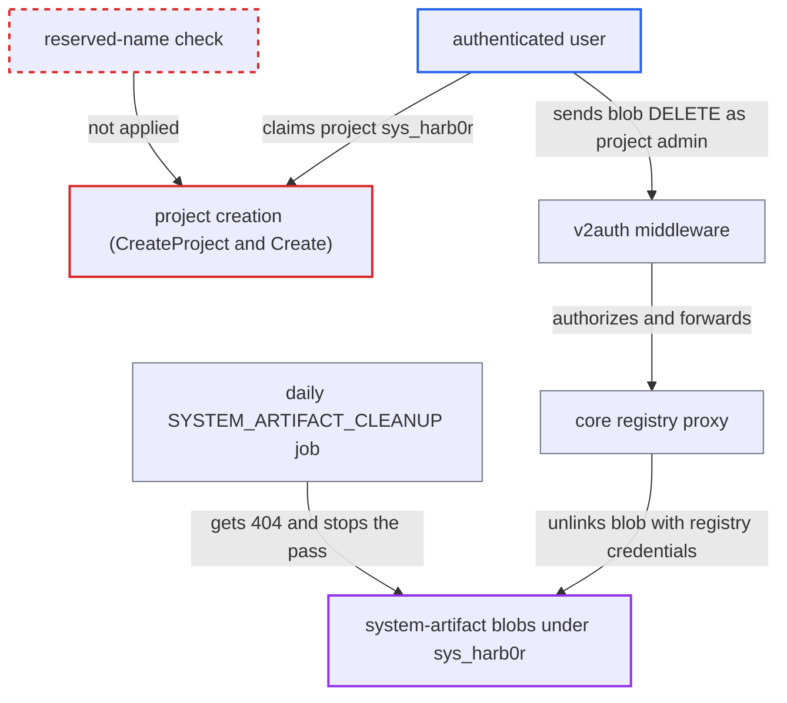

# Reserved system-artifact project name sys_harb0r can be claimed by any user

| Field | Value |
|---|---|
| ID | `find_018xkZU8ND2sK2UkQUKwvAff` |
| Severity | **Low** |
| Status | open |
| CWE | CWE-863 — Incorrect Authorization |
| Created | 2026-10-27T21:29:45.966971Z |
| Claude Security | https://claude.ai/security/findings/find_018xkZU8ND2sK2UkQUKwvAff |

## Description

Any logged-in user can stop Harbor's daily cleanup of system artifacts, such as scan-data export CSVs. They can also delete other users' export blobs when they can reproduce the content. It works on instances where `project_creation_restriction` is still `everyone`, its default. The code at fault is project creation (`CreateProject` and `Create`), which does not reject the reserved name `sys_harb0r`. `v2auth` then trusts the claimed project.

1. **attacker (any authenticated user)** creates a project named `sys_harb0r`. Project creation checks only the length and the regex `^[a-z0-9]+(?:[._-][a-z0-9]+)*$`, which this name matches, and the creator becomes project admin. ([`src/pkg/project/manager.go:72-88`](https://github.com/cx-benchmark/harbor/blob/d822d80c2e6edb2c85538d4b9cd73c0c375a5596/src/pkg/project/manager.go#L72-L88))
2. **attacker** downloads one of their own scan-data exports to learn the SHA-256 of the CSV. A download deletes the blob and its record, but the attacker now knows the digest of content they can regenerate. ([`src/server/v2.0/handler/scanexport.go:195-203`](https://github.com/cx-benchmark/harbor/blob/d822d80c2e6edb2c85538d4b9cd73c0c375a5596/src/server/v2.0/handler/scanexport.go#L195-L203))
3. **attacker** runs the identical export again. The job stores the new CSV as a blob under `sys_harb0r/scan_data_export/scandata_export_<execID>`, with a content-derived digest and a sequential execution id, so the blob has the known digest. ([`src/jobservice/job/impl/scandataexport/scan_data_export.go:143-144`](https://github.com/cx-benchmark/harbor/blob/d822d80c2e6edb2c85538d4b9cd73c0c375a5596/src/jobservice/job/impl/scandataexport/scan_data_export.go#L143-L144))
4. **attacker** sends `DELETE /v2/sys_harb0r/scan_data_export/scandata_export_<id>/blobs/<digest>` with basic auth. `v2auth` looks up the first path segment as a project and grants the project admin access, and the core proxy forwards the request with the registry credentials to a registry that has `delete.enabled: true`. ([`src/server/middleware/v2auth/auth.go:68-77`](https://github.com/cx-benchmark/harbor/blob/d822d80c2e6edb2c85538d4b9cd73c0c375a5596/src/server/middleware/v2auth/auth.go#L68-L77))
5. **the proxy route in `route.go`** passes the blob DELETE straight to the registry. The registry unlinks the blob, but the `system_artifact` row stays behind. ([`src/server/registry/route.go:92-129`](https://github.com/cx-benchmark/harbor/blob/d822d80c2e6edb2c85538d4b9cd73c0c375a5596/src/server/registry/route.go#L92-L129))
6. **the cleanup function `cleanup`** stops its pass at the orphaned record on the daily `SYSTEM_ARTIFACT_CLEANUP` run. `DeleteBlob` returns a 404 error for that row, `cleanup` returns at the first error, and `Cleanup` still returns `nil`, so the job reports success. ([`src/pkg/systemartifact/manager.go:253-262`](https://github.com/cx-benchmark/harbor/blob/d822d80c2e6edb2c85538d4b9cd73c0c375a5596/src/pkg/systemartifact/manager.go#L253-L262))

## Assessment

The attacker is any authenticated user on an instance where `project_creation_restriction` is still `everyone`, its default. No victim interaction is needed. The attacker needs a scanned project they can export, and non-empty exports require a registered scanner that has produced reports. To hit another user's export, that user must have exported a project the attacker can also export with the same filters. The attacker can find its sequential execution id by probing DELETEs. Re-poisoning keeps the cleanup stall going.

Impact: The attacker controls the internal `sys_harb0r` namespace and can unlink system-artifact blobs whose content they can reproduce, including other users' exports of shared projects. They cannot change blob content. Each orphaned record silently stops the daily cleanup, so expired exports of all users are no longer reclaimed; how many records are skipped depends on heap order, because `List` has no ORDER BY. The report finds no way to read other users' CSVs, because their digests are not exposed to non-admins. It rates the overall effect as a limited degradation of a maintenance function.

## Recommendation

(1) Project creation (`Create` in `src/pkg/project/manager.go` and `CreateProject` in `src/server/v2.0/handler/project.go`) does not reject names reserved for system artifacts. A user project can therefore shadow the `sys_harb0r` registry namespace, and `v2auth` then authorizes that user on the system-artifact repositories.

Fix criteria: No caller, including admins and robots, can create a project named `sys_harb0r` or any name returned by `systemartifact.Mgr.GetSystemArtifactProjectNames()`. `/v2/sys_harb0r/**` requests are denied for every user security context, whether or not such a project exists. `POST /api/v2.0/projects` with that name returns an error. `GET` and `DELETE /v2/sys_harb0r/scan_data_export/x/blobs/<digest>` are refused for an authenticated user who could previously create projects.

(2) `systemArtifactManager.cleanup` in `src/pkg/systemartifact/manager.go` stops the whole pass at the first blob-delete error and keeps the record. One dangling record therefore disables cleanup for all system artifacts.

Fix criteria: Cleanup continues past per-record failures and treats a missing registry blob (404) as already deleted, so the tracking record is removed. A run with one unlinked blob still deletes the remaining eligible records. It does not leave a permanently failing record.

## Evidence

**https://github.com/cx-benchmark/harbor**

- [`src/pkg/project/manager.go:72-88`](https://github.com/cx-benchmark/harbor/blob/d822d80c2e6edb2c85538d4b9cd73c0c375a5596/src/pkg/project/manager.go#L72-L88)
- [`src/pkg/systemartifact/manager.go:38-39`](https://github.com/cx-benchmark/harbor/blob/d822d80c2e6edb2c85538d4b9cd73c0c375a5596/src/pkg/systemartifact/manager.go#L38-L39)
- [`src/pkg/systemartifact/manager.go:86-88`](https://github.com/cx-benchmark/harbor/blob/d822d80c2e6edb2c85538d4b9cd73c0c375a5596/src/pkg/systemartifact/manager.go#L86-L88)
- [`src/server/v2.0/handler/project.go:107-233`](https://github.com/cx-benchmark/harbor/blob/d822d80c2e6edb2c85538d4b9cd73c0c375a5596/src/server/v2.0/handler/project.go#L107-L233)
- [`src/server/middleware/v2auth/auth.go:68-77`](https://github.com/cx-benchmark/harbor/blob/d822d80c2e6edb2c85538d4b9cd73c0c375a5596/src/server/middleware/v2auth/auth.go#L68-L77)
- [`src/server/registry/route.go:92-129`](https://github.com/cx-benchmark/harbor/blob/d822d80c2e6edb2c85538d4b9cd73c0c375a5596/src/server/registry/route.go#L92-L129)
- [`src/server/v2.0/handler/scanexport.go:195-203`](https://github.com/cx-benchmark/harbor/blob/d822d80c2e6edb2c85538d4b9cd73c0c375a5596/src/server/v2.0/handler/scanexport.go#L195-L203)
- [`src/jobservice/job/impl/scandataexport/scan_data_export.go:143-144`](https://github.com/cx-benchmark/harbor/blob/d822d80c2e6edb2c85538d4b9cd73c0c375a5596/src/jobservice/job/impl/scandataexport/scan_data_export.go#L143-L144)
- [`src/pkg/systemartifact/manager.go:253-262`](https://github.com/cx-benchmark/harbor/blob/d822d80c2e6edb2c85538d4b9cd73c0c375a5596/src/pkg/systemartifact/manager.go#L253-L262)

