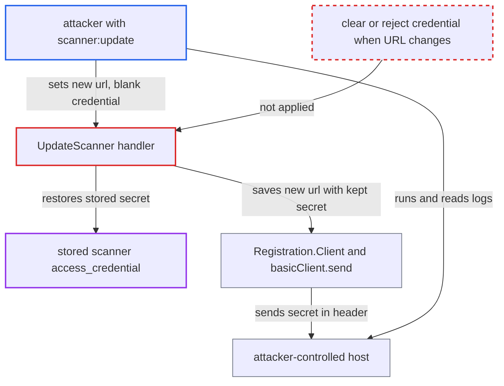

# Scanner update keeps stored credential while URL changes, leaking it to new host

| Field | Value |
|---|---|
| ID | `find_01XnEiuUSpuLLFEqYFht4Gya` |
| Severity | **Low** |
| Status | open |
| CWE | CWE-522 — Insufficiently protected credentials |
| Created | 2026-10-27T21:13:29.446344Z |
| Claude Security | https://claude.ai/security/findings/find_01XnEiuUSpuLLFEqYFht4Gya |

## Description

A sysadmin, or a system robot with `scanner:update`, can steal the stored credential of a scanner that an administrator added with one. The API never returns this credential. The attacker points the scanner's `url` at a host they control and leaves `access_credential` empty. `UpdateScanner` then keeps the old secret, and Harbor sends it to the new host.

1. **attacker with `scanner:update`** sends `PUT /api/v2.0/scanners/{uuid}` with a new `url`. The body points `url` at a host the attacker controls, keeps the existing `auth` type and leaves `access_credential` empty. ([`src/server/v2.0/handler/scanner.go:227-242`](https://github.com/cx-benchmark/harbor/blob/d822d80c2e6edb2c85538d4b9cd73c0c375a5596/src/server/v2.0/handler/scanner.go#L227-L242))
2. **the handler `UpdateScanner`** puts the stored, decrypted secret back into the registration. This happens after `copyToScannerRegistration` has replaced `url` and `skip_cert_verify`, and when `auth` is Basic, Bearer or APIKey. Nothing checks or clears the secret when the URL changes. ([`src/server/v2.0/handler/scanner.go:227-242`](https://github.com/cx-benchmark/harbor/blob/d822d80c2e6edb2c85538d4b9cd73c0c375a5596/src/server/v2.0/handler/scanner.go#L227-L242))
3. **`basicController.UpdateRegistration`** saves the registration with the new URL and the kept secret. It does not ping, check for an endpoint change or reset the credential. It only validates, re-encrypts and persists. ([`src/controller/scanner/base_controller.go:166-176`](https://github.com/cx-benchmark/harbor/blob/d822d80c2e6edb2c85538d4b9cd73c0c375a5596/src/controller/scanner/base_controller.go#L166-L176))
4. **Harbor `GetRegistration`** fetches adapter metadata from the new URL on the next read. A plain GET, a list, `/metadata`, a project scanner lookup or any scan triggers it. The 30s metadata cache only delays the request. ([`src/controller/scanner/base_controller.go:128-151`](https://github.com/cx-benchmark/harbor/blob/d822d80c2e6edb2c85538d4b9cd73c0c375a5596/src/controller/scanner/base_controller.go#L128-L151))
5. **`Registration.Client`** builds the adapter client from the persisted URL and the kept credential. The client therefore points at the attacker's host and carries the old secret. ([`src/pkg/scan/dao/scanner/model.go:135-141`](https://github.com/cx-benchmark/harbor/blob/d822d80c2e6edb2c85538d4b9cd73c0c375a5596/src/pkg/scan/dao/scanner/model.go#L135-L141))
6. **`basicClient.send`** adds the secret to the request sent to the attacker's host. It is sent as `Authorization: Basic …`, `Authorization: Bearer …` or `X-ScannerAdapter-API-Key`, depending on the auth type. ([`src/pkg/scan/rest/v1/client.go:205-212`](https://github.com/cx-benchmark/harbor/blob/d822d80c2e6edb2c85538d4b9cd73c0c375a5596/src/pkg/scan/rest/v1/client.go#L205-L212))
7. **attacker** restores the original URL. The registration looks unchanged afterwards, and the attacker already holds the secret from the request log of their host.

## Assessment

The attacker is a sysadmin, or a system robot granted `scanner:update` on its own without sysadmin rights. The target must be a scanner registration that an administrator added with a credential and Basic, Bearer or APIKey auth. The built-in Trivy registration is immutable and has no auth, so it is not exposed. After repointing the URL, the attacker waits out the 30s metadata cache or lets any GET or scan happen. Any of these reads of the registration sends the secret to the new host.

Impact: The attacker obtains the plaintext scanner adapter credential that Harbor stores encrypted and leaves out of API responses. Repointing the scanner is already within the attacker's rights, so the gain on Harbor is limited to disclosure of this one secret.

Subsequent-system impact: The stolen credential authenticates to the external scanner adapter service as Harbor. The attacker can use that service directly, for example to submit scan requests and fetch reports, which goes beyond what the Harbor API allows.

## Recommendation

`UpdateScanner` keeps the stored credential whatever the endpoint is. A secret entered for one URL can be re-bound to an attacker-chosen URL without being re-supplied. The replication registry handler `UpdateRegistry` already clears the secret in this case, and the scanner path has no such guard.

Fix criteria: An update that changes the registration's normalized URL, or turns on `skip_cert_verify`, while leaving `access_credential` empty is rejected or clears the stored credential, as `UpdateRegistry` does. To verify, repoint a registration with a blank credential and trigger a ping. The old secret must not appear in any request to the new host.

## Evidence

**https://github.com/cx-benchmark/harbor**

- [`src/server/v2.0/handler/scanner.go:227-242`](https://github.com/cx-benchmark/harbor/blob/d822d80c2e6edb2c85538d4b9cd73c0c375a5596/src/server/v2.0/handler/scanner.go#L227-L242)
- [`src/server/v2.0/handler/registry.go:176-184`](https://github.com/cx-benchmark/harbor/blob/d822d80c2e6edb2c85538d4b9cd73c0c375a5596/src/server/v2.0/handler/registry.go#L176-L184)
- [`src/server/v2.0/handler/model/scanner.go:38-55`](https://github.com/cx-benchmark/harbor/blob/d822d80c2e6edb2c85538d4b9cd73c0c375a5596/src/server/v2.0/handler/model/scanner.go#L38-L55)
- [`src/controller/scanner/base_controller.go:166-176`](https://github.com/cx-benchmark/harbor/blob/d822d80c2e6edb2c85538d4b9cd73c0c375a5596/src/controller/scanner/base_controller.go#L166-L176)
- [`src/controller/scanner/base_controller.go:128-151`](https://github.com/cx-benchmark/harbor/blob/d822d80c2e6edb2c85538d4b9cd73c0c375a5596/src/controller/scanner/base_controller.go#L128-L151)
- [`src/pkg/scan/dao/scanner/model.go:135-141`](https://github.com/cx-benchmark/harbor/blob/d822d80c2e6edb2c85538d4b9cd73c0c375a5596/src/pkg/scan/dao/scanner/model.go#L135-L141)
- [`src/pkg/scan/rest/v1/client.go:205-212`](https://github.com/cx-benchmark/harbor/blob/d822d80c2e6edb2c85538d4b9cd73c0c375a5596/src/pkg/scan/rest/v1/client.go#L205-L212)
- [`src/common/rbac/const.go:223-227`](https://github.com/cx-benchmark/harbor/blob/d822d80c2e6edb2c85538d4b9cd73c0c375a5596/src/common/rbac/const.go#L223-L227)

