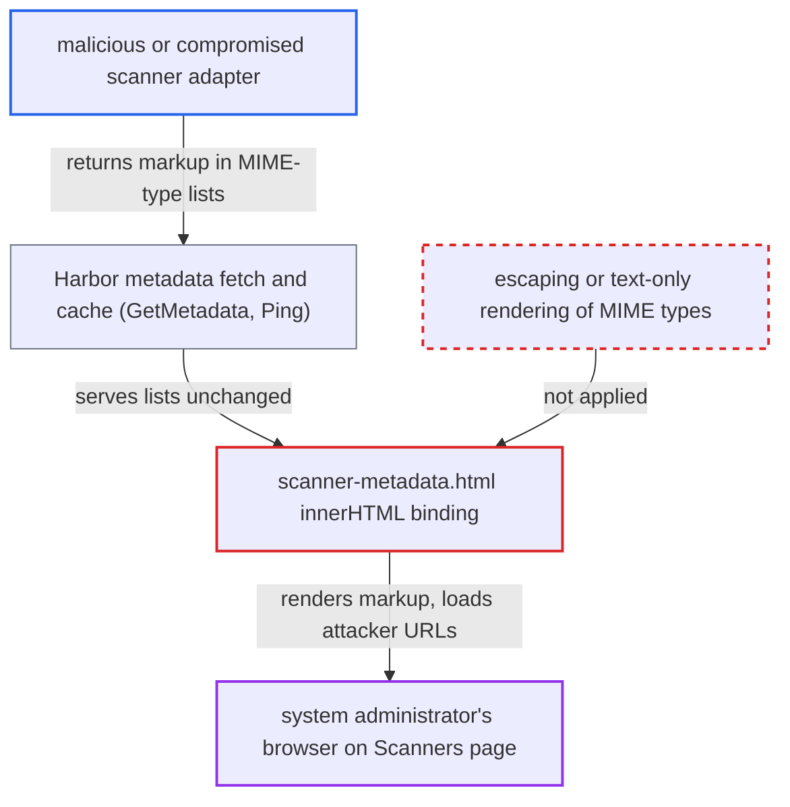

# Scanner-supplied MIME-type strings rendered as HTML on admin Scanners page

| Field | Value |
|---|---|
| ID | `find_01W4CFa17dvRpiFc3AvU2NRv` |
| Severity | **Low** |
| Status | open |
| CWE | CWE-79 — HTML injection |
| Created | 2026-10-27T22:31:45.676424Z |
| Claude Security | https://claude.ai/security/findings/find_01W4CFa17dvRpiFc3AvU2NRv |

## Description

A malicious or compromised scanner adapter can inject HTML into the Scanners page that a Harbor system administrator views. This is HTML injection, not script execution, so it can load attacker URLs from the admin's browser and show spoofed content. It only works where such a scanner is registered. The cause is `scanner-metadata.html`, which binds scanner-supplied MIME-type strings to `[innerHTML]`.

1. **attacker-controlled scanner adapter** returns extra markup in its `/api/v1/metadata` response. The response keeps the required MIME types and adds an entry such as `` to `consumes_mime_types` or `produces_mime_types`.
2. **`basicClient.GetMetadata`** unmarshals the adapter response without changes. The body is copied verbatim into the metadata object, with no cleaning of the strings. ([`src/pkg/scan/rest/v1/client.go:114-137`](https://github.com/cx-benchmark/harbor/blob/d822d80c2e6edb2c85538d4b9cd73c0c375a5596/src/pkg/scan/rest/v1/client.go#L114-L137))
3. **`Validate`** accepts the metadata. It only requires `MimeTypeDockerArtifact` and one supported report type to be in the lists, so every other entry passes unchecked. ([`src/pkg/scan/rest/v1/models.go:84-112`](https://github.com/cx-benchmark/harbor/blob/d822d80c2e6edb2c85538d4b9cd73c0c375a5596/src/pkg/scan/rest/v1/models.go#L84-L112))
4. **`Ping`** caches the metadata and serves it through `GET /api/v2.0/scanners/{id}/metadata`. The lists are returned unchanged by `ToSwagger`, with no sanitising. ([`src/controller/scanner/base_controller.go:306-350`](https://github.com/cx-benchmark/harbor/blob/d822d80c2e6edb2c85538d4b9cd73c0c375a5596/src/controller/scanner/base_controller.go#L306-L350))
5. **`toString()` in `scanner-metadata.component.ts`** joins the MIME-type array into one string. It joins with ` , ` and adds brackets without escaping anything. ([`src/portal/src/app/base/left-side-nav/interrogation-services/scanner/scanner-metadata/scanner-metadata.component.ts:76-81`](https://github.com/cx-benchmark/harbor/blob/d822d80c2e6edb2c85538d4b9cd73c0c375a5596/src/portal/src/app/base/left-side-nav/interrogation-services/scanner/scanner-metadata/scanner-metadata.component.ts#L76-L81))
6. **`scanner-metadata.html`** renders the joined string through `[innerHTML]`. When an admin expands the scanner row, the string is parsed as HTML, and elements such as `` or `<a>` that survive Angular's sanitizer are created. ([`src/portal/src/app/base/left-side-nav/interrogation-services/scanner/scanner-metadata/scanner-metadata.html:27-42`](https://github.com/cx-benchmark/harbor/blob/d822d80c2e6edb2c85538d4b9cd73c0c375a5596/src/portal/src/app/base/left-side-nav/interrogation-services/scanner/scanner-metadata/scanner-metadata.html#L27-L42))

## Assessment

The attacker operates, or has compromised, a scanner adapter registered in Harbor. The adapter needs no Harbor account or privileges. Its `/api/v1/metadata` response keeps the required MIME types and adds markup such as `` or Clarity-classed `
` or `<a>` elements. A system administrator then expands the scanner row on the Scanners page, which the report describes as routine. The attack does nothing where no such scanner is registered.

Impact: No script runs, because Angular's sanitizer removes `<script>`, event handlers, `style` attributes, form controls and unsafe URLs, so Harbor sessions and data are not stolen. The scanner can make the admin's browser load attacker URLs automatically. That reveals when an admin viewed the page, their IP and their user agent, and allows blind GET requests. It can also show spoofed, Clarity-styled content and links on a trusted admin page. The report rates this as limited, since plain links in vulnerability reports are already allowed. The shipped nginx config sends only `Content-Security-Policy: frame-ancestors 'none'`, so remote resources load.

## Recommendation

`scanner-metadata.html` renders scanner-supplied MIME-type strings with `[innerHTML]`. Untrusted remote scanner data is therefore treated as markup in the admin UI.

Fix criteria: Scanner metadata fields are rendered as text only. A scanner that returns `` or `<a href=...>` inside `consumes_mime_types` or `produces_mime_types` shows it as literal text in the expanded scanner row. No element is created and the admin's browser sends no request.

## Evidence

**https://github.com/cx-benchmark/harbor**

- [`src/portal/src/app/base/left-side-nav/interrogation-services/scanner/scanner-metadata/scanner-metadata.html:27-42`](https://github.com/cx-benchmark/harbor/blob/d822d80c2e6edb2c85538d4b9cd73c0c375a5596/src/portal/src/app/base/left-side-nav/interrogation-services/scanner/scanner-metadata/scanner-metadata.html#L27-L42)
- [`src/portal/src/app/base/left-side-nav/interrogation-services/scanner/scanner-metadata/scanner-metadata.component.ts:76-81`](https://github.com/cx-benchmark/harbor/blob/d822d80c2e6edb2c85538d4b9cd73c0c375a5596/src/portal/src/app/base/left-side-nav/interrogation-services/scanner/scanner-metadata/scanner-metadata.component.ts#L76-L81)
- [`src/pkg/scan/rest/v1/client.go:114-137`](https://github.com/cx-benchmark/harbor/blob/d822d80c2e6edb2c85538d4b9cd73c0c375a5596/src/pkg/scan/rest/v1/client.go#L114-L137)
- [`src/pkg/scan/rest/v1/models.go:84-112`](https://github.com/cx-benchmark/harbor/blob/d822d80c2e6edb2c85538d4b9cd73c0c375a5596/src/pkg/scan/rest/v1/models.go#L84-L112)
- [`src/controller/scanner/base_controller.go:306-350`](https://github.com/cx-benchmark/harbor/blob/d822d80c2e6edb2c85538d4b9cd73c0c375a5596/src/controller/scanner/base_controller.go#L306-L350)
- [`src/server/v2.0/handler/scanner.go:112-123`](https://github.com/cx-benchmark/harbor/blob/d822d80c2e6edb2c85538d4b9cd73c0c375a5596/src/server/v2.0/handler/scanner.go#L112-L123)
- [`src/server/v2.0/handler/model/scanner.go:69-85`](https://github.com/cx-benchmark/harbor/blob/d822d80c2e6edb2c85538d4b9cd73c0c375a5596/src/server/v2.0/handler/model/scanner.go#L69-L85)
- [`src/portal/src/app/base/left-side-nav/interrogation-services/scanner/config-scanner.component.html:215-218`](https://github.com/cx-benchmark/harbor/blob/d822d80c2e6edb2c85538d4b9cd73c0c375a5596/src/portal/src/app/base/left-side-nav/interrogation-services/scanner/config-scanner.component.html#L215-L218)

