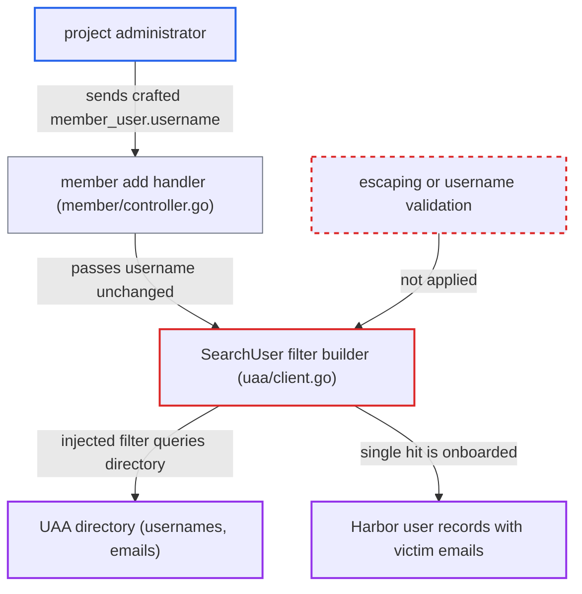

# SCIM filter injection in UAA user search via project member username

| Field | Value |
|---|---|
| ID | `find_01FpgwtLpyfX7BC3cmWdw4tV` |
| Severity | **Low** |
| Status | open |
| CWE | CWE-943 — Filter injection |
| Created | 2026-10-27T21:11:12.234226Z |
| Claude Security | https://claude.ai/security/findings/find_01FpgwtLpyfX7BC3cmWdw4tV |

## Description

A project administrator in Harbor can inject SCIM filter text through a member username. This lets them enumerate UAA usernames and copy matched users' emails into Harbor user records they can read. It needs `auth_mode=uaa_auth`, which is not the default. `SearchUser` in `src/common/utils/uaa/client.go` builds the filter by string formatting without escaping quotes.

1. **project administrator** sends a crafted username in an add-member request. The `member_user.username` field of `POST /api/v2.0/projects/{name}/members` carries a value such as `zz' or userName sw 'ad`, and the attacker needs only admin rights on their own project. ([`src/controller/member/controller.go:166-179`](https://github.com/cx-benchmark/harbor/blob/d822d80c2e6edb2c85538d4b9cd73c0c375a5596/src/controller/member/controller.go#L166-L179))
2. **the member controller** passes the username to `auth.SearchAndOnBoardUser`. This happens when the user is not yet known locally, and the request value is passed along unchanged. ([`src/controller/member/controller.go:166-179`](https://github.com/cx-benchmark/harbor/blob/d822d80c2e6edb2c85538d4b9cd73c0c375a5596/src/controller/member/controller.go#L166-L179))
3. **`defaultClient.SearchUser`** builds the SCIM filter by string formatting. It uses `Username eq '%s'` with no escaping, so the quote in the payload closes the literal and the rest is parsed by UAA as extra filter conditions. ([`src/common/utils/uaa/client.go:148-151`](https://github.com/cx-benchmark/harbor/blob/d822d80c2e6edb2c85538d4b9cd73c0c375a5596/src/common/utils/uaa/client.go#L148-L151))
4. **UAA server** evaluates the injected filter on `/Users`. The query runs with Harbor's client credentials and matches whichever users the attacker's predicates select. ([`src/common/utils/uaa/client.go:148-151`](https://github.com/cx-benchmark/harbor/blob/d822d80c2e6edb2c85538d4b9cd73c0c375a5596/src/common/utils/uaa/client.go#L148-L151))
5. **`Auth.SearchUser`** returns the first entry on exactly one match and errors with "multiple entries found" otherwise. On a single match it builds a Harbor user with `Username` set to the raw injected string and `Email` taken from the matched UAA entry. ([`src/core/auth/uaa/uaa.go:111-135`](https://github.com/cx-benchmark/harbor/blob/d822d80c2e6edb2c85538d4b9cd73c0c375a5596/src/core/auth/uaa/uaa.go#L111-L135))
6. **`SearchAndOnBoardUser`** onboards the returned user and gives the attacker a response oracle. The outcome is one of not found, onboarded, or the `multiple entries found` error, so the attacker can enumerate UAA usernames by prefix, and each single hit is saved as a Harbor user. ([`src/core/auth/authenticator.go:218-231`](https://github.com/cx-benchmark/harbor/blob/d822d80c2e6edb2c85538d4b9cd73c0c375a5596/src/core/auth/authenticator.go#L218-L231))

## Assessment

The attacker is a logged-in Harbor user who is project administrator of any project, including one they own. Harbor must run with `auth_mode=uaa_auth`, which is not the default. They send the add-member request with a filter payload in `member_user.username` for a user not yet onboarded. No victim action is needed. The attack needs no other access.

Impact: The attacker can enumerate every UAA username by prefix search, using the add-member response code as an oracle. For each single match, Harbor creates a user whose username is the injected filter text and whose email is the victim's UAA email, and the attacker can see it in project-member and user listings. The report rates the severity low and says there is no availability impact.

Subsequent-system impact: The external UAA server evaluates the injected filter with Harbor's client authorities. This only allows read-side disclosure of directory attributes such as usernames, emails and any filterable SCIM attribute, through the oracle. The report says nothing in UAA is modified.

## Recommendation

`SearchUser` puts the untrusted username into the SCIM filter string without escaping, so the username can change the structure of the filter.

Fix criteria: Usernames cannot alter the SCIM filter structure. Either quote and backslash characters are escaped per the SCIM string-literal grammar before interpolation, or usernames with characters outside Harbor's allowed username set are rejected before the UAA call. A `member_user.username` containing `'`, `"` or SCIM operators is either rejected or produces a filter that matches only that literal string. The add-member response no longer differs based on whether other users exist.

## Evidence

**https://github.com/cx-benchmark/harbor**

- [`src/common/utils/uaa/client.go:148-151`](https://github.com/cx-benchmark/harbor/blob/d822d80c2e6edb2c85538d4b9cd73c0c375a5596/src/common/utils/uaa/client.go#L148-L151)
- [`src/core/auth/uaa/uaa.go:111-135`](https://github.com/cx-benchmark/harbor/blob/d822d80c2e6edb2c85538d4b9cd73c0c375a5596/src/core/auth/uaa/uaa.go#L111-L135)
- [`src/controller/member/controller.go:166-179`](https://github.com/cx-benchmark/harbor/blob/d822d80c2e6edb2c85538d4b9cd73c0c375a5596/src/controller/member/controller.go#L166-L179)
- [`src/core/auth/authenticator.go:218-231`](https://github.com/cx-benchmark/harbor/blob/d822d80c2e6edb2c85538d4b9cd73c0c375a5596/src/core/auth/authenticator.go#L218-L231)

