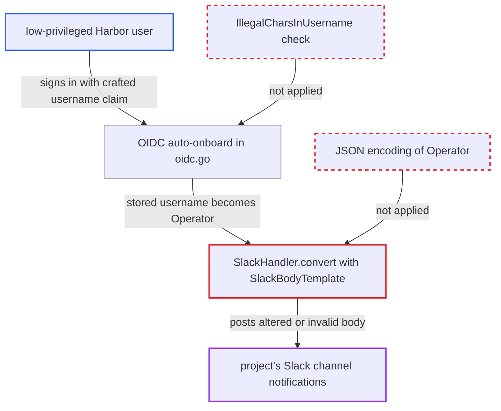

# Slack webhook body built with unescaped text/template lets usernames inject or break notification JSON

| Field | Value |
|---|---|
| ID | `find_01DbfK6vFckW4y9AzhoFA634` |
| Severity | **Low** |
| Status | open |
| CWE | CWE-116 — Improper Output Encoding |
| Created | 2026-10-27T21:15:19.007472Z |
| Claude Security | https://claude.ai/security/findings/find_01DbfK6vFckW4y9AzhoFA634 |

## Description

A low-privileged Harbor user can corrupt the Slack message Harbor posts for events that user triggers. They can add or restructure message blocks, or make the body invalid so Slack drops the notification. This needs a project with a Slack webhook policy and a username containing `"` or ending in `\`, which in practice means OIDC or self-registration. `SlackHandler.convert` inserts `Operator` into a JSON template through `text/template` with no escaping.

1. **attacker** gets a username containing `"` or ending in `\`. With OIDC auto-onboard the username comes from the IdP claim (default `name`), so the attacker needs a claim they can edit, and the path only replaces spaces and applies no `IllegalCharsInUsername` check; with the manual OIDC onboard form or self-registration the attacker picks the name, and `IllegalCharsInUsername` omits the backslash. ([`src/core/controllers/oidc.go:171-196`](https://github.com/cx-benchmark/harbor/blob/d822d80c2e6edb2c85538d4b9cd73c0c375a5596/src/core/controllers/oidc.go#L171-L196))
2. **attacker** pulls, pushes or deletes an artifact in a project with a Slack webhook policy. Every non-HEAD manifest pull fires an event whose `Operator` is the requesting user's username, and pushes and deletes do the same. ([`src/server/registry/manifest.go:131-139`](https://github.com/cx-benchmark/harbor/blob/d822d80c2e6edb2c85538d4b9cd73c0c375a5596/src/server/registry/manifest.go#L131-L139))
3. **the artifact webhook handler** copies the event operator into `Payload.Operator` and sends it to the Slack target. The payload is routed to `SlackHandler` for every policy target of type Slack. ([`src/controller/event/handler/webhook/artifact/artifact.go:111-123`](https://github.com/cx-benchmark/harbor/blob/d822d80c2e6edb2c85538d4b9cd73c0c375a5596/src/controller/event/handler/webhook/artifact/artifact.go#L111-L123))
4. **the handler `SlackHandler.convert`** renders the Slack body with `text/template`, inserting `Operator` unescaped. Only `EventData` goes through `escapeEventData`, so `Operator` is placed as-is. ([`src/pkg/notifier/handler/notification/slack_handler.go:129-145`](https://github.com/cx-benchmark/harbor/blob/d822d80c2e6edb2c85538d4b9cd73c0c375a5596/src/pkg/notifier/handler/notification/slack_handler.go#L129-L145))
5. **the template `SlackBodyTemplate`** places `{{.Operator}}` inside a JSON string literal. A `"` closes the string and lets the attacker change the document, and a trailing `\` escapes the closing quote and makes the JSON invalid. ([`src/pkg/notifier/handler/notification/slack_handler.go:57-62`](https://github.com/cx-benchmark/harbor/blob/d822d80c2e6edb2c85538d4b9cd73c0c375a5596/src/pkg/notifier/handler/notification/slack_handler.go#L57-L62))
6. **the job in `slack_job.go`** posts the rendered string unchanged to the Slack webhook URL. A restructured body is delivered as the attacker shaped it, and an invalid body gets a non-2xx reply, which fails the job so the notification is not delivered. ([`src/jobservice/job/impl/notification/slack_job.go:123-145`](https://github.com/cx-benchmark/harbor/blob/d822d80c2e6edb2c85538d4b9cd73c0c375a5596/src/jobservice/job/impl/notification/slack_job.go#L123-L145))

## Assessment

The attacker is a low-privileged Harbor user on a deployment with a Slack webhook policy on a project. Neither OIDC nor a Slack policy is the default. There are two ways to get a bad username. With OIDC auto-onboard, the IdP must let the user edit the username claim, which allows a `"`. With the manual OIDC onboard form or self-registration, the user picks a username ending in `\`, or one containing `"` where the check does not block it. The attacker then triggers an event the policy covers, such as a pull, push or delete. Usernames from LDAP, auth-proxy or UAA come from the directory or proxy and are normally not chosen by the end user.

Impact: The attacker can change the structure of the Slack message for events they trigger, for example by adding blocks or misreporting the event. They can also make the body invalid so those notifications are silently dropped. Harbor data, artifacts and credentials are not exposed or changed, and HTTP webhooks and audit logs are unaffected. The `operator` field is already shown as Slack `mrkdwn`, so links and mentions in a username are possible even with correct escaping.

## Recommendation

(1) `SlackHandler.convert` builds the JSON body by putting `Operator` and other fields into a JSON text template with `text/template`, without encoding for a JSON string. Characters such as `"` and `\` change the document's structure or validity.

Fix criteria: The Slack body is produced by JSON-marshalling a typed structure, or every substituted value is JSON-string-encoded. A payload whose operator is `a"}},{"x":"` or ends in `\` renders as valid JSON with the block layout unchanged. The literal username appears only in the operator text.

(2) The OIDC auto-onboard path stores the IdP-supplied username without the `IllegalCharsInUsername` check that the manual onboard form and local user creation apply. Usernames can therefore carry characters that string-built output does not expect.

Fix criteria: Usernames created by OIDC auto-onboard pass the same character and length validation as the other user-creation paths, or are rejected or normalised. A token whose username claim contains `"` does not produce a stored username containing it.

## Evidence

**https://github.com/cx-benchmark/harbor**

- [`src/pkg/notifier/handler/notification/slack_handler.go:129-145`](https://github.com/cx-benchmark/harbor/blob/d822d80c2e6edb2c85538d4b9cd73c0c375a5596/src/pkg/notifier/handler/notification/slack_handler.go#L129-L145)
- [`src/pkg/notifier/handler/notification/slack_handler.go:57-62`](https://github.com/cx-benchmark/harbor/blob/d822d80c2e6edb2c85538d4b9cd73c0c375a5596/src/pkg/notifier/handler/notification/slack_handler.go#L57-L62)
- [`src/core/controllers/oidc.go:171-196`](https://github.com/cx-benchmark/harbor/blob/d822d80c2e6edb2c85538d4b9cd73c0c375a5596/src/core/controllers/oidc.go#L171-L196)
- [`src/common/const.go:241`](https://github.com/cx-benchmark/harbor/blob/d822d80c2e6edb2c85538d4b9cd73c0c375a5596/src/common/const.go#L241)
- [`src/controller/event/operator/operator.go:27-42`](https://github.com/cx-benchmark/harbor/blob/d822d80c2e6edb2c85538d4b9cd73c0c375a5596/src/controller/event/operator/operator.go#L27-L42)
- [`src/server/registry/manifest.go:131-139`](https://github.com/cx-benchmark/harbor/blob/d822d80c2e6edb2c85538d4b9cd73c0c375a5596/src/server/registry/manifest.go#L131-L139)
- [`src/controller/event/handler/webhook/artifact/artifact.go:111-123`](https://github.com/cx-benchmark/harbor/blob/d822d80c2e6edb2c85538d4b9cd73c0c375a5596/src/controller/event/handler/webhook/artifact/artifact.go#L111-L123)
- [`src/jobservice/job/impl/notification/slack_job.go:123-145`](https://github.com/cx-benchmark/harbor/blob/d822d80c2e6edb2c85538d4b9cd73c0c375a5596/src/jobservice/job/impl/notification/slack_job.go#L123-L145)

