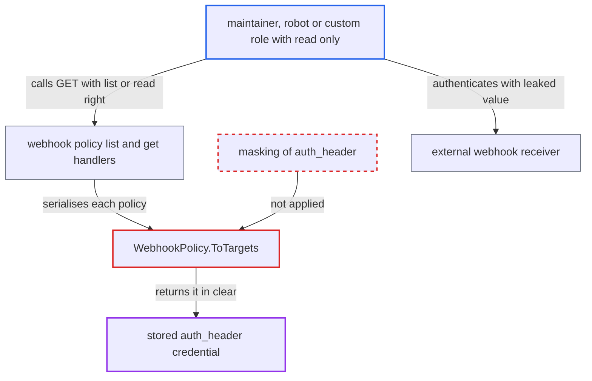

# Webhook policy read API discloses Authorization header secret to read-only project roles

| Field | Value |
|---|---|
| ID | `find_011Gq7n6RGzp5ZzK4Lp6hVKd` |
| Severity | **Low** |
| Status | open |
| CWE | CWE-522 — Insufficiently Protected Credentials |
| Created | 2026-10-27T21:11:17.682057Z |
| Claude Security | https://claude.ai/security/findings/find_011Gq7n6RGzp5ZzK4Lp6hVKd |

## Description

A project maintainer, or a robot account or custom role that has only read access to webhook policies, can read the `Authorization` credential an admin configured for a webhook receiver. It works only when an admin has set an HTTP webhook with an `auth_header`. `WebhookPolicy.ToTargets` copies the stored `auth_header` into the API response, and nothing masks it.

1. **project admin** configures an HTTP webhook with an `auth_header`. Harbor stores the value as plaintext JSON in `notification_policy.targets` and later sends it as the `Authorization` header to the receiver. ([`src/pkg/notification/policy/model/model.go:51-66`](https://github.com/cx-benchmark/harbor/blob/d822d80c2e6edb2c85538d4b9cd73c0c375a5596/src/pkg/notification/policy/model/model.go#L51-L66))
2. **attacker with read-only webhook access** calls `GET /api/v2.0/projects/{p}/webhook/policies` or `GET /api/v2.0/projects/{p}/webhook/policies/{id}`. The attacker is a maintainer, a robot account or a custom-role holder with `notification-policy` `list` or `read` but no update right, and these endpoints require only that. ([`src/server/v2.0/handler/webhook.go:111-149`](https://github.com/cx-benchmark/harbor/blob/d822d80c2e6edb2c85538d4b9cd73c0c375a5596/src/server/v2.0/handler/webhook.go#L111-L149))
3. **`WebhookPolicy.ToTargets`** copies `t.AuthHeader` into each `WebhookTargetObject` of the response. No masking happens here or in the controller or policy manager, so the stored credential goes out unchanged. ([`src/server/v2.0/handler/model/webhook_policy.go:46-58`](https://github.com/cx-benchmark/harbor/blob/d822d80c2e6edb2c85538d4b9cd73c0c375a5596/src/server/v2.0/handler/model/webhook_policy.go#L46-L58))
4. **attacker** uses the leaked value against the webhook receiver. Harbor itself sends this value as the `Authorization` header, so it authenticates to the external system. ([`src/pkg/notifier/handler/notification/http_handler.go:78-80`](https://github.com/cx-benchmark/harbor/blob/d822d80c2e6edb2c85538d4b9cd73c0c375a5596/src/pkg/notifier/handler/notification/http_handler.go#L78-L80))

## Assessment

The attacker must be a project maintainer, or a project robot account or custom-role principal that holds `notification-policy` read or list without update. A project admin must already have set up an HTTP webhook with an `auth_header`. The attacker reaches the `/api/v2.0/*` endpoints over the network, and no victim action is needed. Either the list endpoint or the single-policy endpoint returns the value.

Impact: The attacker gets the stored webhook credential, which the portal and the role design keep from roles that cannot manage webhooks. It gives no extra access inside Harbor itself, so the effect on Harbor is limited to disclosure of a secret it holds.

Subsequent-system impact: With the leaked `Authorization` value the attacker can authenticate to the webhook receiver. They can also send forged Harbor event notifications and use the token for whatever else the receiver allows. How far this reaches depends on the receiver, and the report does not say more.

## Recommendation

`ToTargets` in `src/server/v2.0/handler/model/webhook_policy.go` puts the stored `AuthHeader` into policy read and list responses. Every holder of `notification-policy` read or list therefore receives the receiver credential, including roles without update rights.

Fix criteria: Policy GET and list responses never contain the stored `auth_header` value. A mask or a presence flag is enough. An update request that omits the value or sends the placeholder keeps the stored header, so the edit flow still works. To verify, call `GET .../webhook/policies` and `GET .../webhook/policies/{id}` as a maintainer, a read-only robot and a project admin. Check that the configured header never appears and that webhook delivery still sends it.

## Evidence

**https://github.com/cx-benchmark/harbor**

- [`src/server/v2.0/handler/model/webhook_policy.go:46-58`](https://github.com/cx-benchmark/harbor/blob/d822d80c2e6edb2c85538d4b9cd73c0c375a5596/src/server/v2.0/handler/model/webhook_policy.go#L46-L58)
- [`src/server/v2.0/handler/webhook.go:111-149`](https://github.com/cx-benchmark/harbor/blob/d822d80c2e6edb2c85538d4b9cd73c0c375a5596/src/server/v2.0/handler/webhook.go#L111-L149)
- [`src/common/rbac/project/rbac_role.go:167-168`](https://github.com/cx-benchmark/harbor/blob/d822d80c2e6edb2c85538d4b9cd73c0c375a5596/src/common/rbac/project/rbac_role.go#L167-L168)
- [`src/pkg/notifier/handler/notification/http_handler.go:78-80`](https://github.com/cx-benchmark/harbor/blob/d822d80c2e6edb2c85538d4b9cd73c0c375a5596/src/pkg/notifier/handler/notification/http_handler.go#L78-L80)
- [`src/portal/src/app/base/project/webhook/webhook.component.html:69-75`](https://github.com/cx-benchmark/harbor/blob/d822d80c2e6edb2c85538d4b9cd73c0c375a5596/src/portal/src/app/base/project/webhook/webhook.component.html#L69-L75)
- [`src/server/v2.0/handler/replication.go:508-517`](https://github.com/cx-benchmark/harbor/blob/d822d80c2e6edb2c85538d4b9cd73c0c375a5596/src/server/v2.0/handler/replication.go#L508-L517)
- [`src/pkg/notification/policy/model/model.go:51-66`](https://github.com/cx-benchmark/harbor/blob/d822d80c2e6edb2c85538d4b9cd73c0c375a5596/src/pkg/notification/policy/model/model.go#L51-L66)

